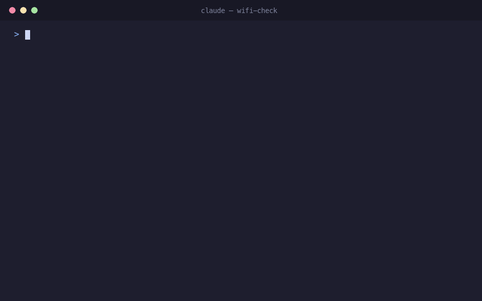

# wifi-check

A [Claude Code](https://claude.com/claude-code) skill that finds out what is slowing down your home Wi-Fi and internet, explains the fixes in plain language, and proves they worked.

By **Mehran Rasheed** · YouTube: [**Think with MR**](https://www.youtube.com/@ThinkwithMRG)



<sub>Summary of a real run; the full report also lists devices and router details, which are left out here for privacy.</sub>

Works with any router and any provider. Runs on **macOS**, **Linux** and **Windows**.

| System | Status |
|---|---|
| macOS 15+ | tested |
| Linux | written, not yet tested on a real machine: reports welcome |
| Windows 10/11 | written, not yet tested on a real machine: reports welcome |

## What it checks

From your computer (read-only, about 45 seconds):

- **Wi-Fi link:** signal strength, noise, channel, band, Wi-Fi standard, connection speed
- **Neighbours:** nearby networks and whether they clash with your channel
- **Lag:** ping to the router and to the internet (average, spikes, packet loss)
- **Where lag starts:** a traceroute shows whether delay begins at home, at your provider or further out (runs automatically when internet lag is high)
- **DNS:** which servers you use and how fast they answer
- **Speed vs your plan:** download and upload compared with what you pay for
- **Lag under load:** an A+ to F bufferbloat grade (Apple's built-in `networkQuality` on macOS; a Cloudflare speed test on Linux and Windows)
- **Devices:** everything that answers on your home network
- **Router security basics:** open ports, UPnP, HTTPS admin page, DS-Lite

**Problems that come and go:** a watch mode pings your router and the internet every few seconds for as long as you like, then lists when the dropouts and spikes happened and whether they were at home or at the provider.

**Wired comparison:** plug in an Ethernet cable and run it again to see whether the problem is your Wi-Fi or your internet.

**Before / after:** after any change, it runs again and shows the numbers side by side, so you know the fix actually worked.

Optionally, from your router's admin page (you sign in yourself; it never types your password):

- Wi-Fi channel and width, band steering, guest network, WPS
- Connected devices with their band and link rate
- Traffic priority (QoS / SQM) options
- Firmware, uptime, firewall, remote admin, port forwarding
- **Line quality from your provider:** cable (DOCSIS), DSL, fibre or mobile readings, judged against rule-of-thumb limits
- **Security audit:** each item rated OK / improve / fix now

**Unknown devices:** it lists every device on your network, helps you work out which ones are yours, and, with your OK, blocks a device you don't recognise. It also explains why changing the Wi-Fi password (and turning WPS off) is the lasting fix: you type the new password yourself; the skill never types or stores it.

It never changes a router setting without asking you first, and explains what each change does before asking.

## Install

One line, then type `/wifi-check` in Claude Code.

**macOS / Linux:**

```bash
git clone https://github.com/mrgoraya/wifi-check.git && mkdir -p ~/.claude/skills && cp -R wifi-check/.claude/skills/wifi-check ~/.claude/skills/
```

**Windows (PowerShell):**

```powershell
git clone https://github.com/mrgoraya/wifi-check.git; New-Item -ItemType Directory -Force "$HOME\.claude\skills" | Out-Null; Copy-Item -Recurse -Force wifi-check\.claude\skills\wifi-check "$HOME\.claude\skills\"
```

This makes the skill available in every Claude Code session. To use it in one project only, open Claude Code inside the cloned `wifi-check` folder instead.

**Update later:** run `git pull` inside the `wifi-check` folder, then the copy step again.

## Use

In Claude Code, type `/wifi-check`, or just say "my Wi-Fi is slow", "who is on my Wi-Fi?" or "my internet drops in the evening".

The scripts also work on their own and print JSON.

macOS:

```bash
zsh .claude/skills/wifi-check/scripts/macos/collect.sh --quick
```

Linux:

```bash
bash .claude/skills/wifi-check/scripts/linux/collect.sh --quick
```

Windows (PowerShell):

```powershell
powershell -ExecutionPolicy Bypass -File .claude\skills\wifi-check\scripts\windows\collect.ps1 -Quick
```

Watch for 30 minutes, ping every 2 seconds (macOS and Linux):

```bash
bash .claude/skills/wifi-check/scripts/watch.sh 30 2
```

Windows:

```powershell
powershell -ExecutionPolicy Bypass -File .claude\skills\wifi-check\scripts\windows\watch.ps1 -Minutes 30 -Interval 2
```

Collector options: `--quick` / `-Quick` (skip speed test), `--trace` / `-Trace` (always traceroute), `--save LABEL` / `-Save LABEL` (keep a copy for before/after).

## Files

```
.claude/skills/wifi-check/
├── SKILL.md                    instructions for Claude: checks, thresholds, report format
├── scripts/
│   ├── macos/collect.sh        data collector for macOS, prints JSON
│   ├── linux/collect.sh        data collector for Linux, prints JSON
│   ├── windows/collect.ps1     data collector for Windows, prints JSON
│   ├── watch.sh                pings over time (macOS and Linux), JSON summary of incidents
│   └── windows/watch.ps1       the same for Windows
└── references/
    ├── line-quality.md         good / borderline / bad limits for cable, DSL, fibre, mobile
    ├── routers.md              where common routers keep their settings
    └── security.md             home network security checklist
```

## Limits

- **macOS:** version 15 or newer (uses the built-in `jq`; on older macOS, `brew install jq`).
- **Linux:** needs `jq`, `ip`, `ping` and `curl`; works best with `iw`, `nmcli`, `dig` and `traceroute`. Nearby-network signal comes from `nmcli` as a percentage and is converted to approximate dBm.
- **Windows:** Wi-Fi details come from `netsh wlan`, whose labels depend on the Windows language. English and German are recognised; on other languages some Wi-Fi fields may be empty. Signal is approximate and there is no noise reading.
- **Linux and Windows speed test** uses a single connection to Cloudflare and can under-read lines faster than about 500 Mbps.
- The device scan assumes a typical home network (`/24`, e.g. 192.168.x.1–254).
- The open-port check only looks from inside your home, not from the internet.
- Line-quality limits are rules of thumb; providers use different exact limits.
- Router menus change with firmware. Pull requests adding or fixing routers in `references/routers.md` are welcome.

## Privacy

Everything runs locally. The scripts send nothing anywhere except normal pings, a traceroute, DNS lookups and a speed test (Apple's on macOS, Cloudflare's on Linux and Windows). Saved results and watch logs stay on your computer in `~/.wifi-check/` (Windows: `%USERPROFILE%\.wifi-check\`), outside this repository. Your router and Wi-Fi passwords are never typed or stored by the skill.

## Author

Made by **Mehran Rasheed**, creator of the YouTube channel [**Think with MR**](https://www.youtube.com/@ThinkwithMRG).

## License

[MIT](LICENSE) © 2026 Mehran Rasheed
